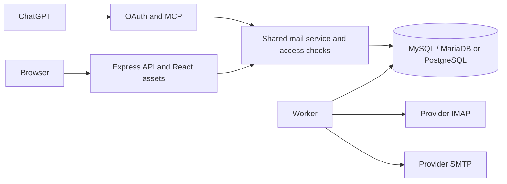

# Architecture

The React UI and Express API share one origin. The web process also serves OAuth and stateless Streamable HTTP MCP. A separate worker imports mail, evaluates rules and processes approved outgoing messages. The demo embeds its worker and uses synthetic data.

## Modules

| Area | Source |
| --- | --- |
| HTTP routes, application setup | server/app.ts, server/main.ts |
| Identity, access and transport security | server/auth.ts, access.ts, security.ts |
| OAuth and MCP | server/oauth.ts, mcp.ts |
| Shared mailbox operations | server/mail-service.ts |
| Provider connections and MIME handling | server/providers.ts |
| Sync, monitoring and outbox | server/worker.ts, worker-main.ts |
| Database adapters and migrations | server/db.ts, mysql.ts, schema.ts, mysql-schema.ts |
| React interface | web/main.tsx, web/style.css |

## Boundaries and data flow

Workspace roles and explicit mailbox grants constrain access. Browser API and MCP operations use server-side checks; worker sends recheck authorisation. Mailbox credentials are encrypted with a runtime key separate from the database. Host operators with both key and database remain trusted.

Imports use folder, UIDVALIDITY and UID identifiers. Cached message data is searchable; attachments are obtained through authenticated routes. Monitoring creates deduplicated alerts. Mail content remains untrusted.

Draft edits invalidate approval. Approval binds the exact version/content hash. Queue claims and recorded states prevent blind retries; uncertain SMTP delivery needs manual reconciliation. SMTP acceptance does not prove delivery.

Single web instance plus a worker is the intended deployment. Rate limits are process-local. Shared-hosting process limits and cron intervals constrain throughput. This design has no automatic scaling or credential-encryption key rotation. OAuth refresh tokens rotate, with replay detection and a 90-day absolute renewal lifetime.
